# 开发工作台（dsh-devwork）

[](https://github.com/wjinxuan/dsh-workbench/actions/workflows/ci.yml)

DeepSeek Harness 的单机插件：在左侧栏加一个「开发工作台」，用项目组织你自己当前的设计、
产品逻辑、开发、测试、调研、运维任务；**多个项目可以同时推进**，状态实时同步（SSE + 轮询兜底），
agent 通过工具读写同一份数据并用 `dev_item` 回报进展。

## 能力

- **项目**：任务归属到项目；顶部项目切换器可在「全部项目」与单个项目之间切换（筛选会记住）；
  「项目」视图用卡片总览每个项目的状态、完成率、各状态计数与最近到期。
- **项目关联空间**：每个项目可绑定一个 DSH 工作区（空间）；项目卡、切换器菜单显示所属空间，
  派给 agent 的任务会话会在该空间打开（项目对话框里选「空间」，默认当前看板空间）。
- **看板**：待办 / 进行中 / 待验收 / 受阻 / 已完成五列；拖拽移动，也有卡片菜单与键盘路径；
  「全部项目」模式下卡片带项目色点标签。
- **今日**：需要你决定的事、指标条（进行中/今日到期/逾期/待验收/停滞 + 完成率）、
  进行中 / 到期 / 待验收 / 受阻 / 停滞分栏；尊重当前项目筛选。
- **列表**：类型 / 状态 / 优先级筛选 + 全文搜索的紧凑表格，含项目列。
- **活动**：按天分组的时间线，人 / agent / 系统分别标记；按当前项目过滤。
- **任务详情**：标题、所属项目、类型、状态、优先级、负责人、到期、估时/已用、进度、描述、
  标签、检查清单、交付物、本任务活动流；一键「交给 agent 执行 / 复核 / 拆解」发起会话。
- **主题**：跟随宿主（默认）+ 三套彩色主题——海洋 / 日落 / 森林；设置面板里切换，选择会记住；
  明暗仍跟随宿主自动适配（主题只改强调色与氛围）。
- **实时**：`EventSource` 订阅 `/devwork/api/stream`；连接不上自动降级 15s 轮询；
  右上角实时/轮询/离线徽标；外部变更提示「看板已同步」。
- **agent 工具**：`dev_board`（读，可按项目过滤）、`dev_project`（项目列表 / 新建 / 修改）、
  `dev_item`（建/改/移/回报，可指定项目）、`dev_attention`（提问/查看）、`dev_brief`（按项目简报）。

## 预览

> 以下为独立渲染夹具（stub 数据 + 宿主主题 token）在无头 Chromium 中的截图，**不是真实宿主截图**；
> 真实宿主里已验证面板入口、数据加载、SSE 实时徽标与任务抽屉（见「验证」）。

| 今日（深色） | 看板（深色，卡片带项目标签） |
|---|---|
| 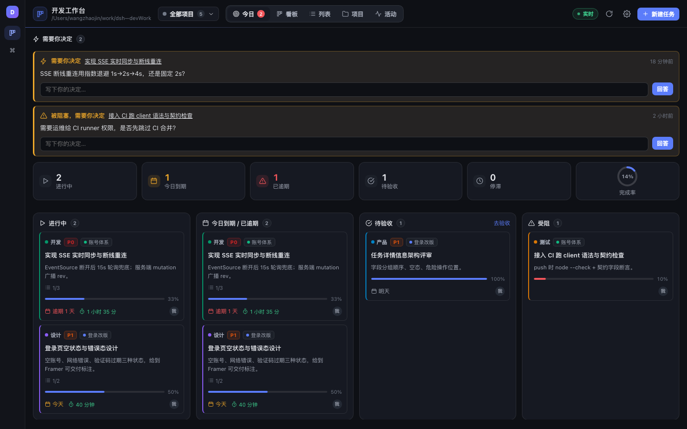 | 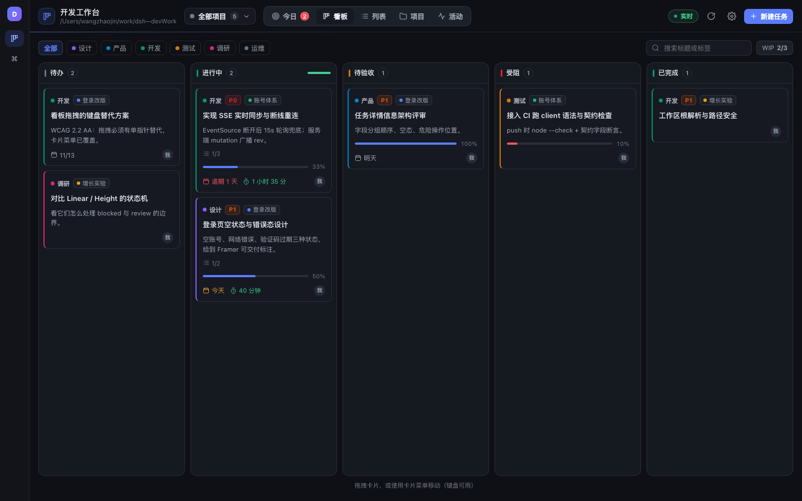 |

| 项目总览（含所属空间） | 项目切换器（显示空间） |
|---|---|
| 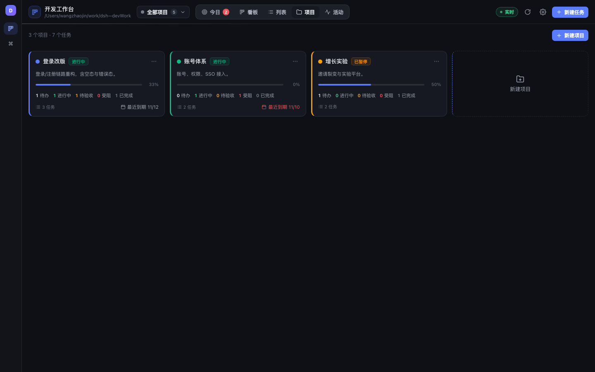 | 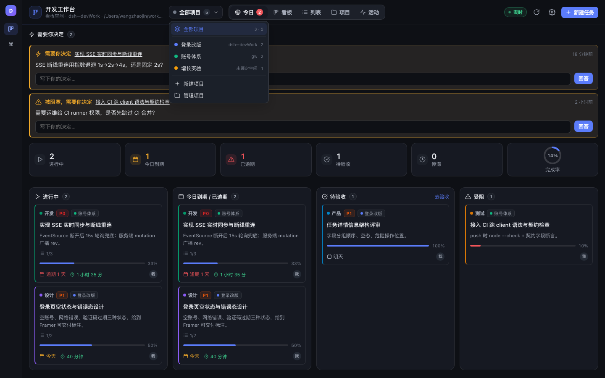 |

| 项目关联空间 | 主题选择（设置） |
|---|---|
| 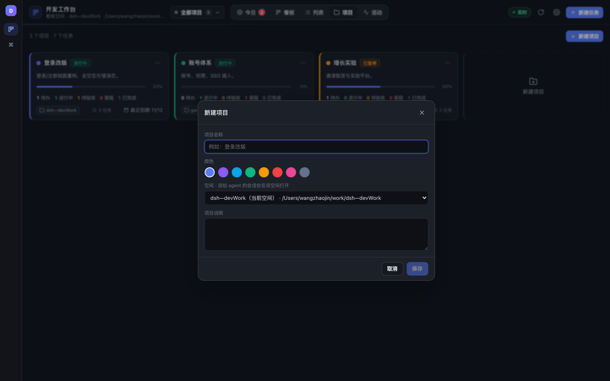 | 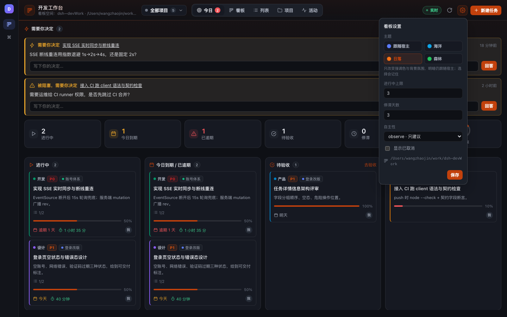 |

| 海洋主题 | 日落主题 | 森林主题 |
|---|---|---|
| 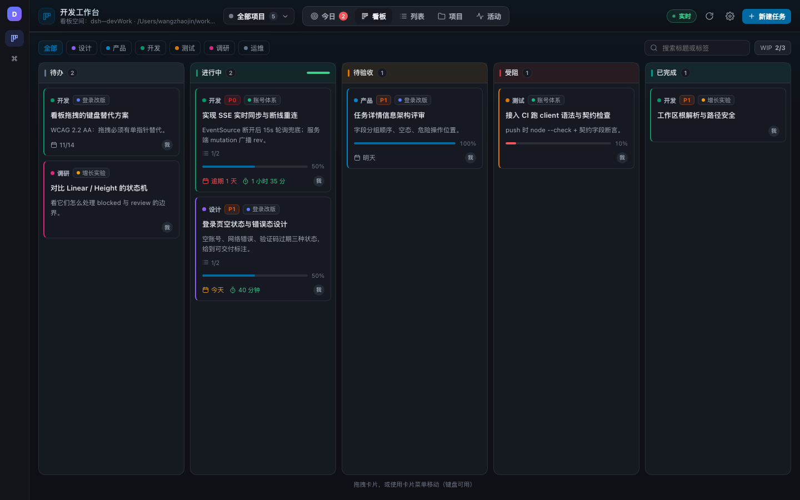 | 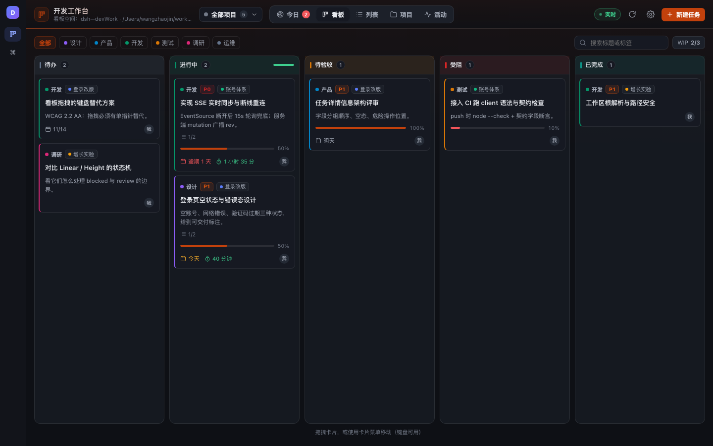 | 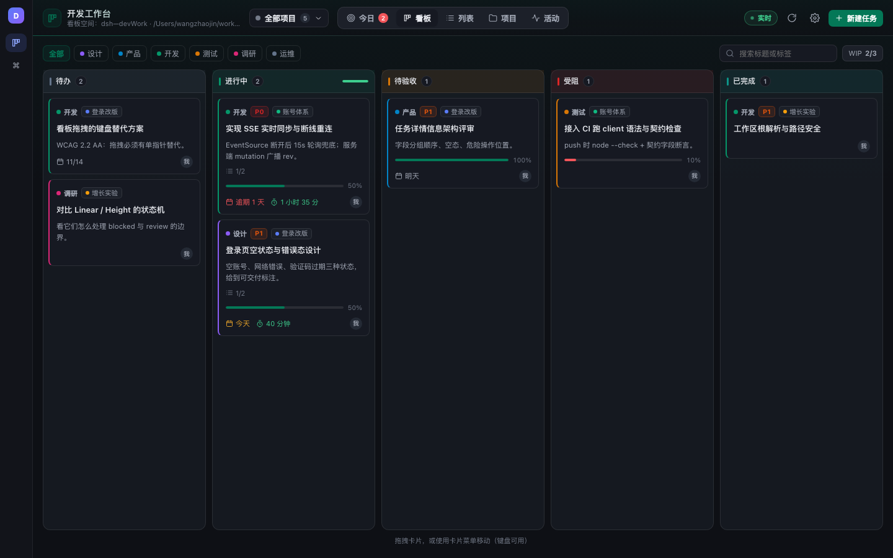 |

| 森林主题（浅色宿主） | |
|---|---|
| 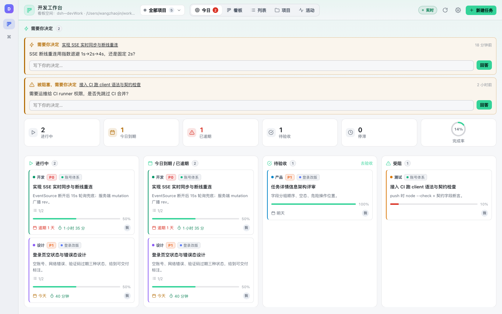 | |

| 任务抽屉（深色） | 今日（浅色） |
|---|---|
| 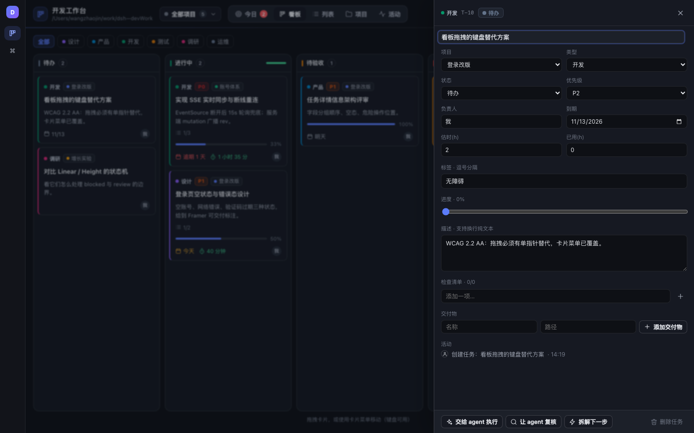 | 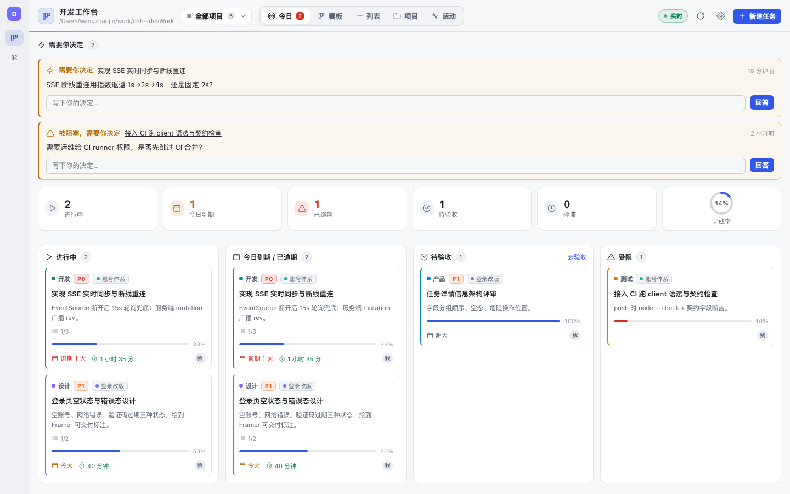 |

| 项目总览（浅色） | |
|---|---|
| 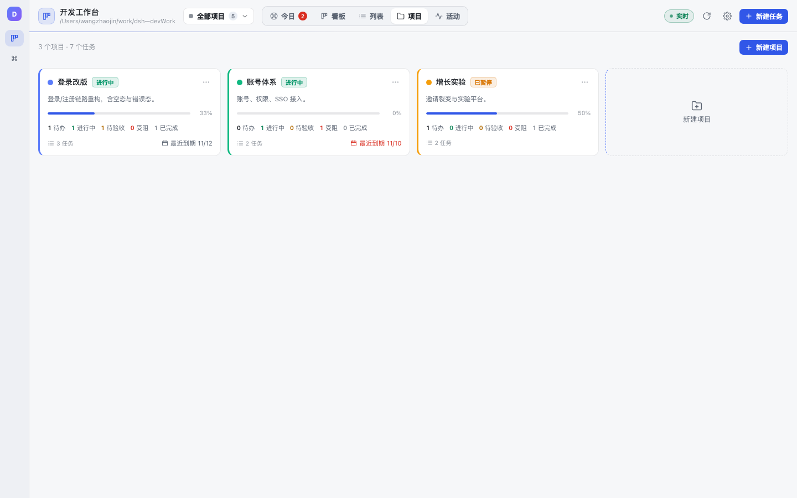 | |

## 安装

**从 GitHub 安装（推荐）**

```bash
dsh plugin --profile web add github:wjinxuan/dsh-workbench
dsh --profile web --dump-config   # 验证挂载
# 重启 dsh web 生效
```

**在 DeepSeek Harness Desktop 里安装**

```text
plugin_manager action=install_bundle target=github:wjinxuan/dsh-workbench
```

**本地开发**

```text
plugin_manager action=install_bundle target=<本仓库绝对路径>
```

安装后左侧栏出现「开发工作台」图标；若图标未出现，重启宿主并刷新页面。

- 源码 / Issue：<https://github.com/wjinxuan/dsh-workbench>
- 市场收录进度：[MARKETPLACE.md](MARKETPLACE.md)
- 许可证：MIT · 变更记录：[CHANGELOG.md](CHANGELOG.md)

## 数据

- 位置：`<工作区根>/.devwork/board.json`（每个工作区一份；面板右上角显示当前根）。
- 数据版本 v3：`projects[]`（含 `workspaceId/workspacePath/workspaceTitle` 空间绑定）+
  `tasks[].projectId`；v1/v2 旧板读入时自动迁移，不丢任务。
- 唯一事实源；写入为 tmp + rename 原子替换，坏 JSON 会备份成 `board.json.bad-<ts>` 后重建。
- 可回滚：删除 `.devwork/` 即回到空看板。
- 任务编号 `T-1`、注意力编号 `A-1`，永不复用。

## 状态机与红线

```
待办 → 进行中 → 待验收 → 已完成
  ↘ 受阻 ↗         ↘ 返工
```

- **已完成只能由人验收**（面板内二次确认）；agent 的 `dev_item report ready` 只进「待验收」。
- **删除任务只能由人**；agent 工具没有删除。**删除项目也只能由人**（有任务时需确认移到「未归属」）。
- **注意力只能由人回答**；agent 只能 `dev_attention ask` / `list`。
- 非法流转返回 `409 INVALID_TRANSITION`。

## agent 用法

```text
dev_project action=create name="登录改版" color="#5B7CFA" workspace="dsh—devWork"
dev_project action=update project=登录改版 workspace=""   # 解除空间绑定
dev_project action=list                     # 看项目 + 各项目统计 + 可用空间
dev_board  view=brief                     # 今天该干什么（全部项目）
dev_board  view=brief project=登录改版      # 只看某项目
dev_item   action=create patch={title:"实现 SSE 重连", type:"dev", priority:"P1", due:"2026-11-14", project:"登录改版"}
dev_item   action=move   id=T-3 status=doing
dev_item   action=report id=T-3 report={kind:"ready", text:"已实现，见 artifacts", artifacts:["src/stream.js"]}
dev_attention action=ask question="重连退避用 1s 还是 2s？"
dev_brief  period=today apply=false
```

## HTTP API

前缀 `/devwork/api`（同源、JSON、`Cache-Control: no-store`）：

| 方法 | 路径 |
|---|---|
| GET | `/meta` · `/state` · `/stream`（SSE） |
| POST | `/project/create` · `/project/update`（可带 `workspace` 绑定） · `/project/delete`（人） |
| POST | `/task/create` · `/task/update` · `/task/move` · `/task/delete` · `/task/checkin` |
| POST | `/attention/ask` · `/attention/resolve` · `/settings/update` · `/handoff` |

字段与响应契约见 [CONTRACT.md](CONTRACT.md)。

## 键盘

`n` 新建 · `1–5` 切换今日/看板/列表/项目/活动 · `Esc` 关闭抽屉或对话框 · 卡片 `Enter` 打开
· 卡片菜单「移动到」可用键盘完成状态流转；项目切换器与项目卡菜单均可用键盘操作。

## 开发

```bash
node --check index.js && node --check client.js
```

- 宿主半：`index.js` + `src/store.js` + `src/util.js`
- 前端半：`client.js`（无 JSX，`window.__ModuleLoader__` 懒工厂，React 来自宿主模块表）
- 设计说明：[DESIGN.md](DESIGN.md)；实现契约：[CONTRACT.md](CONTRACT.md)

## 验证

已做（v0.2 多项目）：

- 宿主半：v1→v2 迁移、项目 CRUD、按项目过滤、跨项目统计、删除保护（PROJECT_NOT_EMPTY / HUMAN_ONLY）。
- 真机：安装 `application=applied`；`dev_project` 建项目、`dev_item` 指定项目、`dev_board project=` 过滤、
  `dev_brief project=` 抬头均联调。

已做（v0.1 基础）：

- 宿主半：`node --check` 通过；mock ctx 联调 12 条路由、4 个工具、SSE hello/广播/清理、
  405/415/400/404/409、handoff 成功与降级；状态机红线（agent 调 done/delete/resolve 全部拒绝）。
- 真机：DeepSeek Harness Desktop 安装 `application=applied`，左侧栏出现「开发工作台」，
  面板加载真实看板数据、SSE 显示「实时」、任务抽屉读写正常（本机 `<workspace>/.devwork/board.json`）。
- 前端：无头 Chromium + stub 宿主渲染四视图、任务抽屉、新建对话框，深/浅两套 token 截图核对；
  `node --check client.js` 通过。

未做 / 边界：

- 未在真实宿主里逐项手工点过全部交互（拖拽、验收确认弹窗、handoff 打开会话）；
  这些路径已由 mock 联调与静态检查覆盖，实际手感需你在面板里确认。
- 未做移动端/触屏验证（面板是桌面 Web UI，宽度 <900px 时看板转横向滚动）。

## 兼容性

- 宿主：DeepSeek Harness Desktop（`manifestVersion 1`，`dsh.client.platform: web`）。
- 依赖可选服务：`webServer`、`connection`、`workspaceRegistry`、`sessionController`；
  缺失时工具仍可用，面板显示读取失败与原因。
- 不读写其它插件的 DOM / 样式 / 状态；容器只用 `--dsw-alias-*` 主题 token。
